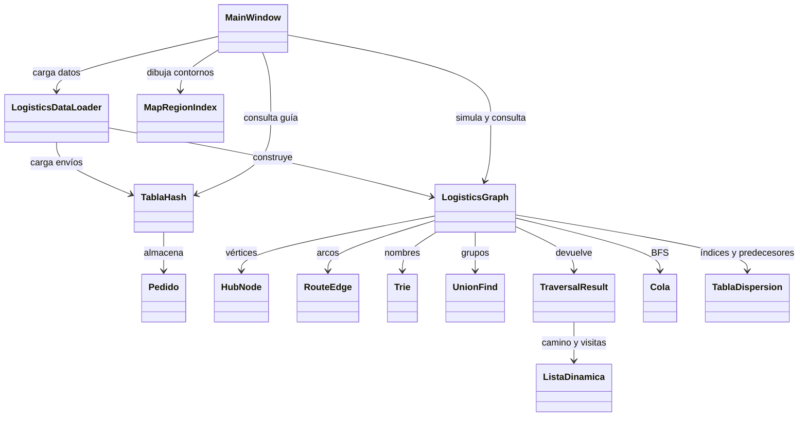
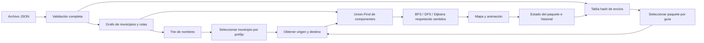

# Manual técnico — UFG ENVIOS

## Escenario y alcance

Aplicación de escritorio para simular entregas entre los 24 municipios del mapa de Quetzaltenango. Un envío posee guía, remitente, destinatario, origen, destino y estado. Una ruta posee distancia, costo, tiempo y sentido. Los datos de ejemplo contienen 30 envíos y 44 relaciones: 39 bidireccionales y 5 dirigidas (83 arcos en memoria).

La aplicación carga los datos desde JSON y los conserva en memoria durante la sesión. El mapa y las rutas son una representación didáctica; los pesos son simulados. El grafo admite nodos desconectados, pero la interfaz exige coordenadas y semillas válidas dentro de los contornos del mapa existente. No se agregan municipios ajenos a ese mapa.

## Organización

| Carpeta o archivo | Responsabilidad |
|---|---|
| `Models/` | Entidades `HubNode`, `RouteEdge`, `Pedido` y resultados de algoritmos. |
| `Algorithms/` | Estructuras propias, recorridos, optimización e índices. |
| `Data/LogisticsDataLoader.cs` | Deserialización y validación de un conjunto completo. |
| `Data/MapRegionIndex.cs` | Segmentación de la imagen, contornos y sombreado. |
| `Data/Samples/` | JSON de datos y consultas de prueba. |
| `MainWindow.xaml` | Controles y estilos de la interfaz WPF. |
| `MainWindow.xaml.cs` | Registro, estados, mapas, animación y navegación. |
| `MainWindow.Consultas.cs` | Búsqueda, autocompletado, recorridos, conectividad e importación. |
| `Tests/` | Verificación de estructuras, algoritmos, carga, interfaz y capturas. |

## Clases y relaciones

### Entidades

- `HubNode`: ID y código, nombre, número en el mapa, posición visual, semilla del contorno y tipo de estación.
- `RouteEdge`: origen y destino, `DistanceKm`, `Cost`, `EstimatedHours`, modo terrestre y `Bidirectional`. Un enlace bidireccional produce dos arcos con los mismos pesos.
- `Pedido`: `Guia`, `Remitente`, `Destinatario`, `OrigenId`, `DestinoId` y `Estado`. `Cliente` es un alias de presentación de `Remitente`, ignorado al serializar JSON.
- `TraversalResult`: camino, orden de descubrimiento/visita, tramos, kilómetros, costo total, tiempo estimado y duración del cálculo. La duración del algoritmo y las horas estimadas del recorrido son medidas distintas.

## Estructuras y algoritmos

Sea V la cantidad de municipios, E la cantidad de arcos, N la cantidad de paquetes, L la longitud de un texto y R el tamaño del resultado.

| Estructura u operación | Implementación y costo |
|---|---|
| `TablaHash` | Arreglo de cubetas con cadenas de nodos enlazados. Hash polinómico base 31 sobre la guía. Inserción, búsqueda y eliminación O(L) para calcular el hash más O(1) esperado por cubeta; peor caso O(L + N). Crece al alcanzar una carga de 0.75 y redistribuye los nodos. Espacio O(N + cubetas). |
| `TablaDispersion<TKey,TValue>` | Tabla genérica propia con encadenamiento; usa igualdad y función hash del tipo de clave. Índices de municipios, predecesores, marcadores y contornos. O(1) esperado, O(N) peor caso, sin contar el cálculo del hash. |
| `ListaDinamica<T>` | Arreglo propio que duplica capacidad. Agregar O(1) amortizado; insertar/eliminar en medio O(N); acceso O(1). Implementa `IList<T>` y notificaciones para enlazar con WPF. |
| `Cola<T>` | Nodos enlazados con frente y final; encolar/desencolar O(1). Se usa en BFS y en el procesamiento del mapa. |
| `Conjunto<T>` | Se apoya en la tabla de dispersión propia para controlar visitas y duplicados. |
| BFS | Cola y tabla de predecesores. O(V + E) esperado, memoria O(V). Encuentra el menor número de aristas en el grafo dirigido. |
| DFS | Recursión, conjunto de visitados y predecesores. O(V + E) esperado, memoria O(V). Su ruta depende del orden de las adyacencias y no garantiza un óptimo. |
| Dijkstra | Tabla de distancias, predecesores y conjunto de nodos resueltos. Selección lineal del mínimo: O(V² + E) esperado, memoria auxiliar O(V). Optimiza uno de los tres pesos no negativos. |
| Union-Find | Arreglos de padres y tamaños; compresión de caminos y unión por tamaño. O(α(V)) amortizado por operación. Se reconstruye de forma diferida cuando cambian los nodos o las conexiones. |
| Trie | Cada carácter normalizado conduce a un nodo con tabla de hijos propia. Insertar O(L) esperado; localizar un prefijo O(L), más el recorrido del subárbol para reunir sugerencias. Los hijos se ordenan para obtener resultados estables. |

Las colecciones internas de WPF (controles, geometrías, columnas), las interfaces, LINQ y los arreglos siguen siendo parte del framework. El almacenamiento y las estructuras de los algoritmos, el índice del mapa y el historial usan las implementaciones propias del proyecto.

### Decisiones y sacrificios

- **Tabla hash:** acelera la consulta por guía a cambio de memoria adicional y un orden de enumeración que no representa el orden de registro. Las colisiones se resuelven con cadenas, no sobrescribiendo pedidos.
- **Lista de adyacencia:** evita una matriz V×V para la red dispersa. Buscar una conexión específica recorre las salidas del vértice; enumerar vecinos es directo.
- **Dijkstra con selección lineal:** para 24 vértices es sencillo de explicar y revisar. Sacrifica escalabilidad frente a un montículo propio, que permitiría O((V + E) log V).
- **Union-Find:** responde consultas repetidas sobre grupos con poco costo. Ignora los sentidos: A→B une el grupo de A y B, pero no prueba que exista B→A. Para eso se ejecuta BFS. Una eliminación futura de aristas exigiría reconstruir los grupos.
- **Trie:** comparte prefijos y evita recorrer todos los nombres en cada búsqueda. Consume nodos y tablas de hijos adicionales. Normaliza mayúsculas y tildes, conservando el nombre original para mostrarlo.
- **Estructuras propias:** permiten explicar su funcionamiento y cumplir el objetivo académico, con más código y responsabilidad de prueba que las colecciones del framework.
- **DFS recursivo:** es legible con 24 municipios; una red mucho mayor necesitaría controlar la profundidad de la pila.

## Integración de las cuatro estructuras

Cada alta de nodo alimenta el índice Trie. Cada cambio del grafo invalida la caché de Union-Find. Los recorridos rechazan IDs desconocidos y pares en componentes distintos; si están en el mismo componente, exploran respetando la dirección de cada arco. La guía identifica un pedido en la tabla hash y suministra sus municipios al recorrido. Al completar la animación se actualiza el mismo pedido y se agrega una entrada al historial.

## Dijkstra y reconstrucción

1. Inicializar las distancias en infinito y el origen en cero.
2. Elegir el vértice pendiente con menor distancia finita.
3. Marcarlo resuelto y relajar sus arcos salientes usando distancia, costo o tiempo.
4. Guardar el predecesor cuando se mejora una distancia.
5. Terminar al resolver el destino o al no quedar vértices alcanzables.
6. Reconstruir el camino desde el destino hasta el origen e invertirlo. Sumar los tres atributos del camino, aunque solo uno se haya optimizado.

Origen igual a destino produce un camino de un vértice y totales cero. Si no hay camino, `Success` es falso. Se aceptan pesos cero y se rechazan pesos negativos o no finitos. Los totales de costo y horas se redondean a dos decimales al presentar el resultado.

## Carga y validación

`LogisticsDataLoader.Load` crea un grafo y una tabla hash nuevos. Valida campos obligatorios, IDs y guías únicos, municipios existentes, números de mapa únicos, coordenadas, rutas duplicadas, pesos y remitente/destinatario. Los campos principales de rutas y las tres secciones del JSON son obligatorios. Un JSON inválido produce `InvalidDataException`.

La interfaz construye además un nuevo `MapRegionIndex`. Solo después de que ambas validaciones terminan reemplaza la sesión. Un archivo rechazado conserva los datos actuales. Una carga exitosa reemplaza los datos y limpia el historial. El JSON se distribuye junto al ejecutable mediante `CopyToOutputDirectory` y `CopyToPublishDirectory`.

Las consultas de prueba están en un archivo separado para que no se confundan con los datos que carga la aplicación. Véase [PRUEBAS.md](PRUEBAS.md) para su formato y ejecución.

## Estados y animación

`Registrado → EnTransito → Entregado`. Un recorrido imposible establece `SinRuta`. Se bloquean los cambios de algoritmo y de paquete durante una simulación. La comparación usa dos tareas de animación que se esperan conjuntamente. Cancelar mediante Limpiar recorrido restaura el estado anterior. El historial solo registra simulaciones completadas.

## Verificación y límites

La suite usa Floyd-Warshall, implementado con una matriz independiente, para contrastar Dijkstra en todos los pares y los tres pesos. Un grafo adicional tiene óptimos diferentes por atributo, un municipio aislado y conexiones de un sentido. También verifica crecimiento y colisiones de hash, datos inválidos, consultas y funcionamiento WPF. La prueba visual genera capturas para inspección.

No hay persistencia automática, edición de rutas desde la interfaz ni conexión con carreteras o servicios de navegación. El JSON es el punto de entrada para cambiar la red y los envíos iniciales.
